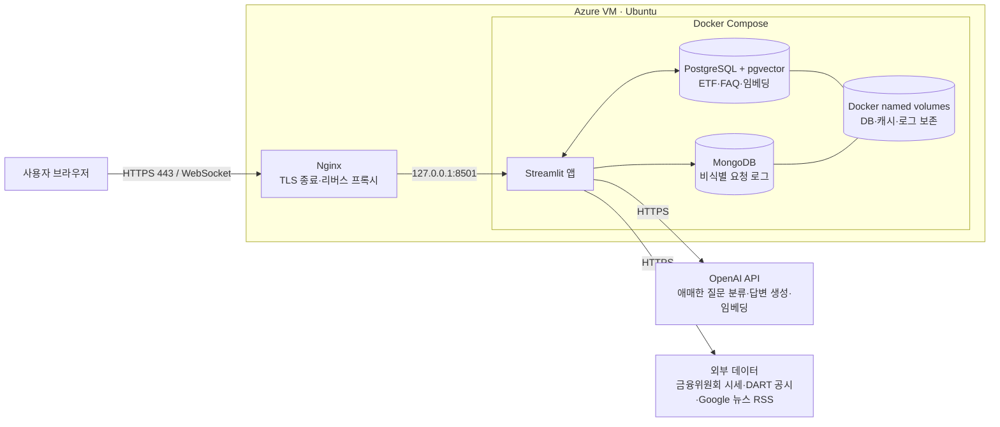
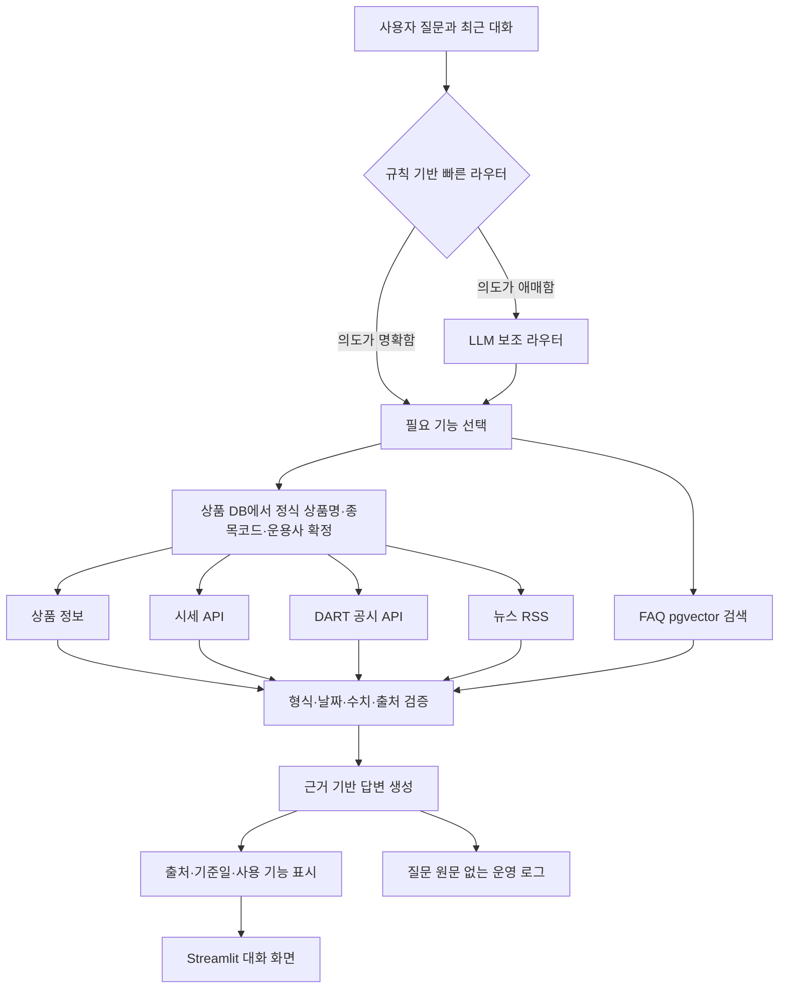
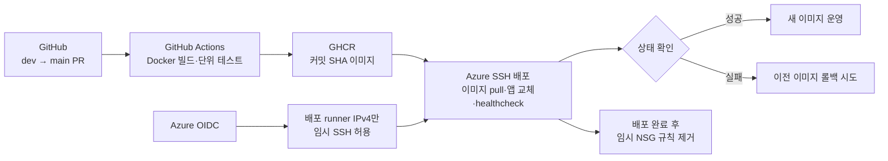

# ETF AI 상담센터 아키텍처

이 문서는 현재 `main` 브랜치와 Azure 운영 환경을 기준으로 애플리케이션 구조,
데이터 흐름, 배포 방식과 운영상 경계를 설명합니다.

## 1. 아키텍처 요약

사용자는 HTTPS로 Azure VM의 Nginx에 접속합니다. Nginx는 TLS를 종료하고
호스트의 `127.0.0.1:8501`에서 실행되는 Streamlit 컨테이너로 요청을 전달합니다.
애플리케이션은 질문을 분류한 뒤 필요한 상품·FAQ·시세·공시·뉴스 기능만 호출하고,
검증된 결과를 근거로 답변을 생성합니다.

현재 구조는 완전히 독립된 여러 LLM 에이전트가 서로 통신하는 멀티 에이전트 구조가 아닙니다.
규칙 기반 라우터와 보조 LLM 라우터가 전문 기능 모듈을 선택하는 단일 애플리케이션 구조입니다.

## 2. 질문 처리 흐름

### 처리 원칙

1. 외부 API를 호출하기 전에 PostgreSQL에서 정식 상품명과 종목코드·운용사를 확정합니다.
2. 시세·공시·뉴스 결과는 LLM에 전달하기 전에 날짜, 수치, 상품명과 출처 도메인을 코드로 검증합니다.
3. 기준일 가격은 실시간 가격으로 표현하지 않습니다.
4. 공시 제목만으로 실제 변경 내용을 추측하지 않습니다.
5. 확인되지 않은 상품이나 수치는 생성하지 않습니다.
6. 매수·매도·보유 판단이나 특정 상품 추천은 제공하지 않습니다.

## 3. 애플리케이션 구성

| 구성 요소 | 역할 |
| --- | --- |
| `app.py` | Streamlit 화면, 세션 대화 기록, 처리 상태와 출처 표시 |
| `consultation.py` | 라우팅 결과에 따라 전문 기능 실행, 결과 취합과 답변 생성 |
| `orchestrator.py` | 규칙 기반 빠른 분류, 애매한 질문의 LLM 분류, 후속 질문의 상품 문맥 해석 |
| `src/services/product_catalog.py` | 상품명·종목코드 정규화, 오타 후보 탐색, 정식 상품 확정 |
| `agent_tools.py` | ETF 상품 DB와 FAQ 검색 도구 |
| `api_tools.py` | 시세·공시 도구 인터페이스 |
| `news_tools.py` | 뉴스 검색 도구 인터페이스 |
| `result_validator.py` | 시세·공시 결과의 형식·기간·수치·출처 검증 |
| `src/services/vector_search.py` | pgvector 기반 FAQ 의미 검색 |
| `src/services/request_logger.py` | 질문 원문 없이 사용 기능·처리시간·오류·캐시 상태 기록 |

## 4. 데이터 계층

### PostgreSQL + pgvector

- 공개 자료 기반 ETF 상품 20개
- 출처가 포함된 FAQ 75개
- `text-embedding-3-large`, 1536차원 임베딩
- HNSW 인덱스를 이용한 코사인 유사도 검색
- FAQ 검색 기본값: `top-k=3`, 최소 유사도 `0.55`

### MongoDB

- 무작위 세션 ID
- 질문 길이와 질문 분야 요약
- 사용 도구와 처리 상태
- 라우터·외부 API·답변 생성 단계별 응답시간
- 캐시 적중 여부와 오류 유형
- 사용자 질문 및 답변 원문은 저장하지 않음

### 영속성

운영 DB, MongoDB, 애플리케이션 캐시와 로그는 Docker named volume에 보존됩니다.
앱 컨테이너를 교체해도 named volume은 유지되지만, VM이나 디스크 삭제에 대비한
외부 백업과 복원 검증은 별도로 필요합니다.

## 5. 외부 서비스

| 서비스 | 용도 | 적용된 안전장치 |
| --- | --- | --- |
| OpenAI API | 애매한 질문 분류, 답변 생성, 임베딩 | 조회하지 않은 수치 생성 금지, 필요한 경우만 LLM 라우터 호출 |
| 금융위원회 API | ETF 최근 기준일 종가·NAV | 상품 DB 선확정, 비실시간 표시, 수치·기준일 검증 |
| DART API | 운용사 관련 공시 제목·날짜·링크 | 운용사 고유번호 캐시, 검색 상태 구분, 링크·기간 검증 |
| Google 뉴스 RSS | 최근 ETF 뉴스 후보 | 프로토타입용 공개 소스, 날짜·링크 검증, 요청 범위 링크 토큰 치환 |

## 6. 로컬과 Azure 운영 환경

| 항목 | 로컬 개발 | Azure 운영 |
| --- | --- | --- |
| 실행 | Docker Compose | Azure VM의 Docker Compose |
| 외부 진입점 | `localhost:8501` | Nginx HTTPS 443 |
| 앱 포트 | `127.0.0.1:8501` | `127.0.0.1:8501`, 외부 직접 공개 안 함 |
| TLS | 사용하지 않음 | Let's Encrypt 인증서, Nginx TLS 종료 |
| 데이터 | 로컬 named volume | 운영 named volume |
| 비밀정보 | Git에서 제외된 `.env` | VM의 권한 제한 `.env`와 GitHub Environment |

운영 URL은 `https://etf-agent.koreacentral.cloudapp.azure.com`입니다.

## 7. CI/CD 구조

### 브랜치별 동작

| 이벤트 | 빌드·테스트 | GHCR 게시 | Azure 운영 배포 |
| --- | --- | --- | --- |
| Pull Request | 실행 | 하지 않음 | 하지 않음 |
| `dev` push | 실행 | 실행 | 하지 않음 |
| `main` push | 실행 | 실행 | 실행 |

배포 이미지는 `latest`가 아니라 커밋 SHA로 식별합니다. GitHub Actions는 Azure OIDC로
인증한 뒤 현재 runner의 IPv4만 NSG에 임시 허용하고, SSH 배포 후 해당 규칙을 제거합니다.
배포 스크립트는 앱 healthcheck에 실패하면 이전 로컬 이미지로 롤백을 시도합니다.

## 8. 현재 운영상 한계

- Google 뉴스 RSS는 프로토타입용 공개 소스이며 상용 서비스에서는 정식 뉴스 공급원 검토가 필요합니다.
- 뉴스 링크 토큰과 원문 URL의 매핑은 각 상담 요청 안에서만 유지되고 요청 종료 시 폐기됩니다.
- 공시는 제목·날짜·링크를 제공하며 공시 원문 본문 분석은 수행하지 않습니다.
- 독립적인 최종 답변 검토 에이전트는 아직 구현하지 않았습니다.
- Azure 운영 DB에는 최신 FAQ 75개, 임베딩 모델과 임계값이 로컬 설정과 같은지 확인해야 합니다.
- healthcheck는 애플리케이션 프로세스 상태를 확인하며 외부 API와 RAG 질의 성공까지 보장하지 않습니다.
